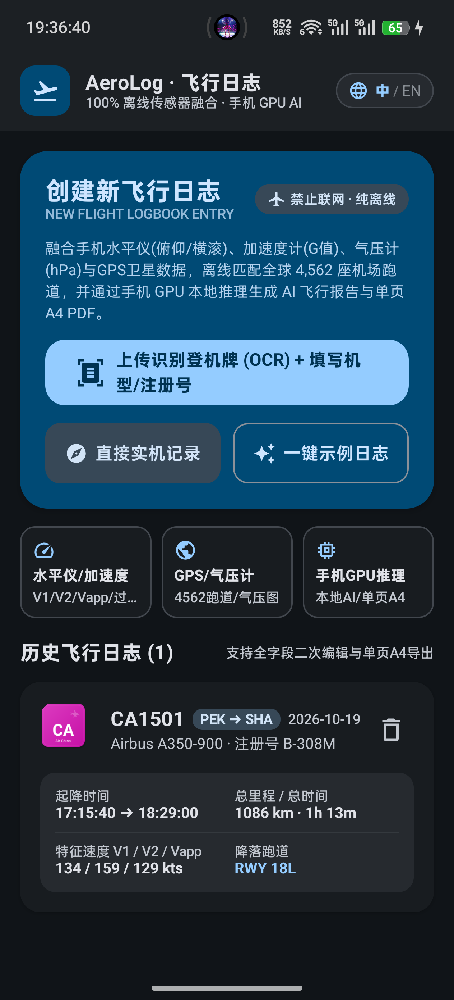
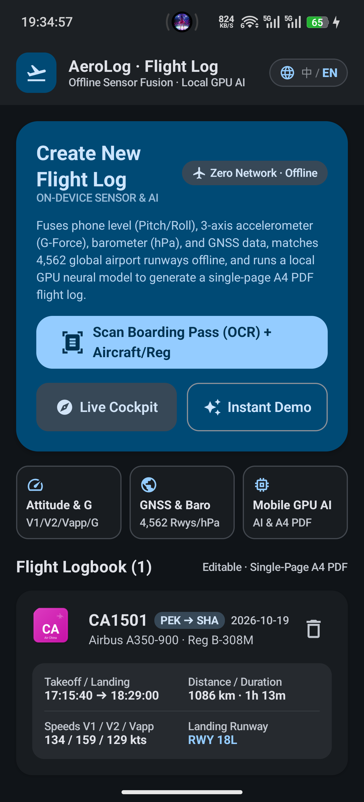
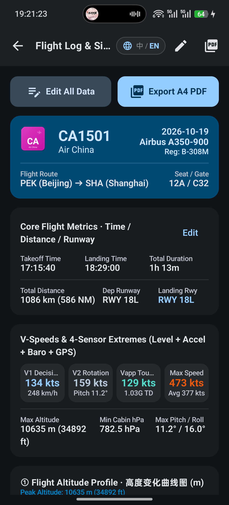
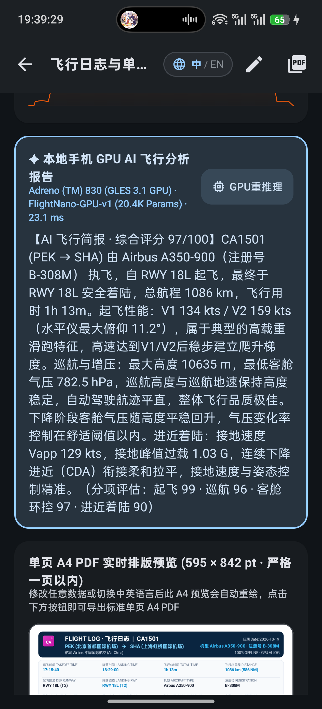
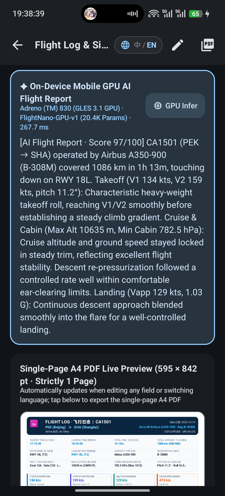
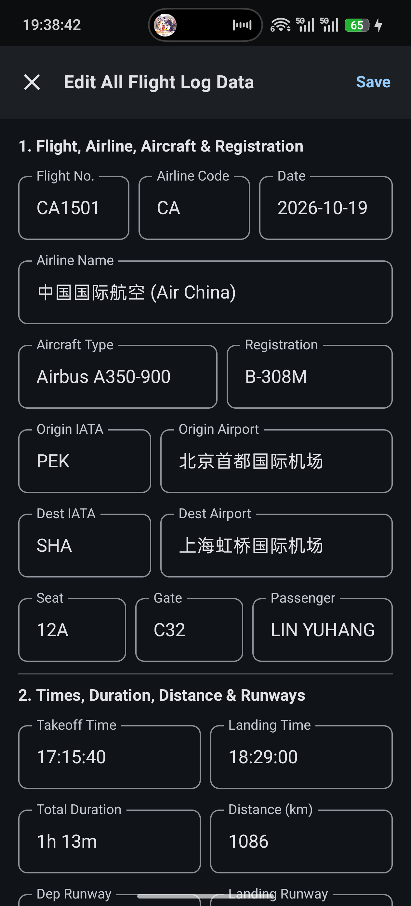

# AeroLog (FlightLogger) — 100% Offline Avionics Flight Logbook

[](https://github.com/xlh080401/FlightLogger/releases/latest)
[](https://github.com/xlh080401/FlightLogger/releases/download/v1.0.0/FlightLogger-v1.0.0.apk)
[-3DDC84?logo=android)](https://developer.android.com)
[](https://m3.material.io)
[-success)](#overview)
[](#overview)
[](LICENSE)

**English** | [简体中文](#简体中文说明) | **[📦 Download APK (v1.0.0)](https://github.com/xlh080401/FlightLogger/releases/tag/v1.0.0)**

---

## Overview

**AeroLog (FLOG4)** is an air-gapped, **100% offline** Android flight logging application engineered for aviation enthusiasts, frequent flyers, and student pilots. It fuses data from your phone's built-in **Attitude/Level sensor (`TYPE_ROTATION_VECTOR`)**, **3-Axis Accelerometer (`TYPE_ACCELEROMETER`)**, **Barometer (`TYPE_PRESSURE`)**, and **GNSS (`LocationManager.GPS_PROVIDER`)** during flight, matches takeoff and landing runways against an embedded database of **4,562 global airports**, extracts boarding pass details via **on-device OCR**, runs a **small-parameter neural network (`FlightNano-v1`) on the mobile GPU (`OpenGL ES 3.1` Compute Shader)** to author a bilingual flight assessment, and typesets a **Single-Page A4 PDF Flight Log** (`595 × 842 pt`) with full manual editing support.

### Key Highlights

- **Material Design 3 (MD3) & Bilingual (`中 / EN`) UI**:
  - Built with Jetpack Compose Material 3 (`ElevatedCard`, `OutlinedCard`, `FilledTonalButton`, `FilterChip`, `AssistChip`, tonal surface hierarchy `surfaceContainerLowest` → `surfaceContainerHighest`).
  - Instant **1-tap Chinese / English (`🌐 中 / EN`)** language switching in the top app bar across all screens, GPU AI reports, and exported A4 PDF logs.
- **Strictly Zero Network Access**:
  - `INTERNET` and `ACCESS_NETWORK_STATE` permissions are explicitly stripped from the merged `AndroidManifest.xml` via `tools:node="remove"`, guaranteeing safe operation in Airplane Mode and complete data privacy.
- **4-Sensor Avionics Fusion & Flight Phase State Machine**:
  - Real-time state machine (`BOARDING` → `TAXI` → `TAKEOFF_ROLL` → `ROTATION` → `CLIMB` → `CRUISE` → `APPROACH` → `TOUCHDOWN` → `ROLLOUT` → `COMPLETED`).
  - Automatically computes **$V_1$ (Decision Speed)**, **$V_2$ (Rotation / Takeoff Safety Speed)**, **$V_{app}$ (Approach / Touchdown Speed)**, **Takeoff & Landing Times**, **Total Distance (km)**, **Total Duration**, **Peak Pitch ($\theta_{\max}$)**, **Peak G-Force ($G_{\max}$)**, and **Touchdown G-Force ($G_{td}$)**.
- **3 Full-Flight Telemetry Curves**:
  - **GPS / Barometric Altitude Profile (`ft`)**
  - **Cabin Barometric Pressure Profile (`hPa`)**
  - **Ground Speed Profile (`kts`)** with annotated $V_1$, $V_2$, and $V_{app}$ markers.
- **Offline Global Airport & Runway Matching**:
  - Preloaded `airports.json` covering **4,562 major global airports** and runway headings (`RWY 01L/19R`, `RWY 18L/36R`, etc.), matched offline via Haversine great-circle distance and magnetic track alignment.
- **On-Device Boarding Pass OCR + Guided Aircraft/Registration Input**:
  - Uses bundled offline Google ML Kit Text Recognition (`com.google.mlkit:text-recognition` + `text-recognition-chinese`) with IATA BCBP (`M1LAST/FIRST...`) and regex parsers to extract **Flight Number**, **Airline**, **Origin**, **Destination**, **Date**, **Seat**, and **Gate**, plus a built-in sample boarding pass generator and guided **Aircraft Type & Registration** selector.
- **Mobile GPU Local AI Flight Report (`FlightNano-v1`)**:
  - Executes a 3-layer MLP (`12 → 64 → 32 → 8` with GELU/Sigmoid activations) directly on the phone's GPU using an **OpenGL ES 3.1 Compute Shader (`#version 310 es`)** with a deterministic CPU SIMD fallback, synthesizing a bilingual flight analysis and safety/smoothness score (`/100`).
- **Single-Page A4 PDF Export & Full Manual Editor**:
  - Typesets all flight metadata, airline vector emblem, $V_1/V_2/V_{app}$ speed cards, 3 telemetry curves, and the GPU AI report onto **strictly 1 page of A4 (`595 × 842 pt`)** using Android's native `PdfDocument` API.
  - Every single field can be manually edited and re-exported at any time.

---

## Screenshots (Material Design 3 · Bilingual `中 / EN`)

| Home (中文) | Home (English) | Flight Telemetry & Curves |
| :---: | :---: | :---: |
|  |  |  |

| GPU AI & Single-Page A4 PDF (中文) | GPU AI & Single-Page A4 PDF (English) | Full Manual Editor (MD3) |
| :---: | :---: | :---: |
|  |  |  |

---

## Architecture & Project Structure

```text
FLOG4/
├── app/
│   ├── src/main/
│   │   ├── assets/
│   │   │   ├── airports.json                  # 4,562 global airports & runway headings
│   │   │   ├── aircraft.json                  # Commercial aircraft database & max capacities
│   │   │   ├── logos/                         # Offline SVG airline vector logos (IATA 2-letter codes)
│   │   │   └── models/
│   │   │       ├── flight_ai_nano_v1.bin      # Pre-trained FlightNano-v1 neural weights (FP16/FP32)
│   │   │       └── flight_ai_vocab.json       # Bilingual AI synthesis templates & scoring rules
│   │   ├── java/com/flog4/app/
│   │   │   ├── ai/
│   │   │   │   └── GpuAiInferenceEngine.kt    # GLES 3.1 Compute Shader GPU neural inference (FlightNano-v1)
│   │   │   ├── data/
│   │   │   │   ├── AirportData.kt             # Offline Haversine airport & runway heading matcher
│   │   │   │   ├── AircraftData.kt            # Aircraft type & max passenger capacity lookup
│   │   │   │   ├── Entities.kt                # Room entities (FlightRecord, SensorDataPoint, FlightPhase)
│   │   │   │   ├── FlightDao.kt               # Reactive Flow & suspend DAO queries
│   │   │   │   └── FlightDatabase.kt          # Local Room SQLite database
│   │   │   ├── di/
│   │   │   │   └── AppModule.kt               # Dagger Hilt dependency injection module
│   │   │   ├── log/
│   │   │   │   ├── FlightLogGenerator.kt      # Builds FlightLog & 3 telemetry curve series
│   │   │   │   └── PdfGenerator.kt            # Strictly 1-page A4 (595x842 pt) bilingual PDF renderer
│   │   │   ├── scanner/
│   │   │   │   └── BoardingPassParser.kt      # Offline ML Kit OCR + IATA BCBP & regex parser
│   │   │   ├── service/
│   │   │   │   ├── FlightPhaseDetector.kt     # 4-sensor flight phase state machine
│   │   │   │   ├── SpeedAndTelemetryAnalyzer.kt # V1, V2, Vapp, Pitch, G-Force & Baro altitude analyzer
│   │   │   │   ├── SensorCollectionService.kt # Foreground avionics telemetry service
│   │   │   │   └── SimulatedFlight.kt         # High-fidelity physics & sensor flight simulator
│   │   │   ├── ui/
│   │   │   │   ├── i18n/AppI18n.kt            # Reactive ZH/EN localization & Md3LanguageSwitchPill
│   │   │   │   ├── theme/Theme.kt             # Material Design 3 Dark/Light tonal color system
│   │   │   │   ├── navigation/NavGraph.kt     # Compose Navigation graph
│   │   │   │   ├── home/                      # MD3 Home screen & flight logbook history
│   │   │   │   ├── scanner/                   # MD3 Boarding Pass OCR & guided Aircraft/Reg input
│   │   │   │   ├── recording/                 # Live ADI attitude horizon & sensor cockpit
│   │   │   │   └── detail/                    # Interactive curves, GPU AI card, full editor & A4 PDF preview
│   │   │   └── util/
│   │   │       ├── AirlineLogoRenderer.kt     # Offline SVG + vector badge airline logo renderer
│   │   │       └── TimeUtils.kt               # Timestamp & duration formatting utilities
│   └── src/test/java/com/flog4/app/
│       └── Flog4CoreSystemsTest.kt            # Unit test suite for all offline subsystems
├── .gitignore
├── LICENSE
└── README.md
```

---

## Core Algorithms

### 1. Barometric & Cabin Altitude Conversion
Cabin pressure $P$ ($\text{hPa}$) from `Sensor.TYPE_PRESSURE` is smoothed with an exponential moving average ($\alpha = 0.25$) and converted to pressure altitude ($h_{\text{ft}}$) via the International Standard Atmosphere (ISA) barometric formula:

$$h_{\text{ft}} = 145366.45 \times \left(1 - \left(\frac{P}{1013.25}\right)^{0.190284}\right)$$

### 2. $V_1 / V_2 / V_{app}$ Detection
- **$V_1$ (Decision Speed)**: Recorded during the takeoff roll when longitudinal acceleration stabilizes prior to nose-up pitch initiation.
- **$V_2$ (Rotation Speed)**: Captured at the exact instant pitch angle $\theta \ge 5.5^\circ$ and vertical climb rate turns positive while ground speed $V_g \ge 90\text{ kts}$.
- **$V_{app}$ (Approach / Touchdown Speed)**: Captured during final approach (below $800\text{ ft}$ AGL) at touchdown impact peak ($G_{td}$).

### 3. Haversine Runway Matching
Given touchdown coordinates $(\phi_1, \lambda_1)$ and aircraft ground track $\psi_{\text{track}}$, AeroLog queries `airports.json` using the Haversine distance:

$$d = 2R \arcsin\left(\sqrt{\sin^2\left(\frac{\Delta\phi}{2}\right) + \cos\phi_1\cos\phi_2\sin^2\left(\frac{\Delta\lambda}{2}\right)}\right)$$

and selects the runway threshold whose magnetic heading minimizes $|\Delta \psi|$.

---

## Build & Test Instructions

### Prerequisites
- **Android Studio Ladybug (2024.2.1)+** or Gradle CLI with **JDK 17+**
- **Android SDK 35** (`minSdk = 26`, `targetSdk = 35`)

### Command Line Build
```bash
# Run unit tests
./gradlew testDebugUnitTest

# Build debug APK
./gradlew assembleDebug
```
The compiled APK is generated at `app/build/outputs/apk/debug/app-debug.apk`.

---

<a id="简体中文说明"></a>

## 简体中文说明

**AeroLog (FLOG4)** 是一款专为航空爱好者、常旅客与飞行学员打造的 **100% 纯离线** Android 飞行日志应用。应用采用 **Material Design 3 (MD3)** 规范设计，支持 **中英双语一键实时切换 (`🌐 中 / EN`)**，通过融合手机内置的 **水平仪 (`TYPE_ROTATION_VECTOR`)**、**三轴加速度计 (`TYPE_ACCELEROMETER`)**、**气压计 (`TYPE_PRESSURE`)** 与 **GPS 卫星定位 (`GPS_PROVIDER`)**，在完全断网（飞行模式）下完成全流程飞行数据分析、登机牌 OCR 识别、全球跑道匹配、手机 GPU 本地 AI 推理及单页 A4 PDF 导出。

### 核心特性

1. **严禁联网 · 100% 本地隐私安全**：
   - 在 `AndroidManifest.xml` 中使用 `tools:node="remove"` 彻底移除 `INTERNET` 与 `ACCESS_NETWORK_STATE` 权限，确保在飞行模式下零网络依赖运行。
2. **Material Design 3 界面与中英双语 (`中 / EN`)**：
   - 遵循 Google Material Design 3 色彩容器层级与圆角规范，顶栏内置 `🌐 中 / EN` 胶囊按钮，所有界面、传感器仪表、AI 飞行简报及导出的单页 A4 PDF 均支持中英双语实时切换。
3. **四传感器融合计算与核心航空指标**：
   - 自动解算 **起飞时间**、**降落时间**、**$V_1$ 决断速度**、**$V_2$ 抬轮速度**、**$V_{app}$ 接地速度**、**起降跑道编号**、**飞行总里程 (km)**、**飞行总时间**、**最大俯仰角** 与 **接地过载 ($G$)**。
   - 绘制完整的 **飞行高度变化曲线图 (ft)**、**机舱气压变化曲线图 (hPa)** 与 **飞机地速变化曲线图 (kts)**。
4. **登机牌离线 OCR 识别 + 机型/注册号引导录入**：
   - 内置离线 Google ML Kit 文字识别模型，自动从登机牌图片中提取 **航班号、航空公司、出发地、目的地、日期、座位号、登机口**，并提供测试登机牌一键生成及 **机型 (`Aircraft Type`) / 飞机注册号 (`Registration`)** 引导式填写。
5. **全球 4,562 座机场与跑道离线匹配**：
   - 预置全球主流机场 GPS 坐标与跑道磁航向数据库 (`airports.json`)，通过 Haversine 球面距离与接地航向角自动匹配降落跑道（如 `RWY 18L`、`RWY 36R`）。
6. **手机 GPU 本地推理小参数 AI 模型 (`FlightNano-v1`)**：
   - 基于 **OpenGL ES 3.1 Compute Shader (`#version 310 es`)** 在手机 GPU 上直接运行轻量化多层感知机神经网络，结合飞行数据自动生成中/英文简短飞行评估报告与综合评分。
7. **单页 A4 PDF 精美排版导出与全字段手动编辑**：
   - 严格控制在 **单页 A4 (`595 × 842 pt`)** 以内，包含航司徽标、航班信息、核心速度卡片、三条完整传感器曲线及 GPU AI 飞行简报，且所有数据字段均支持后续手动修改并实时刷新预览。

---

## License

Released under the [MIT License](LICENSE).
